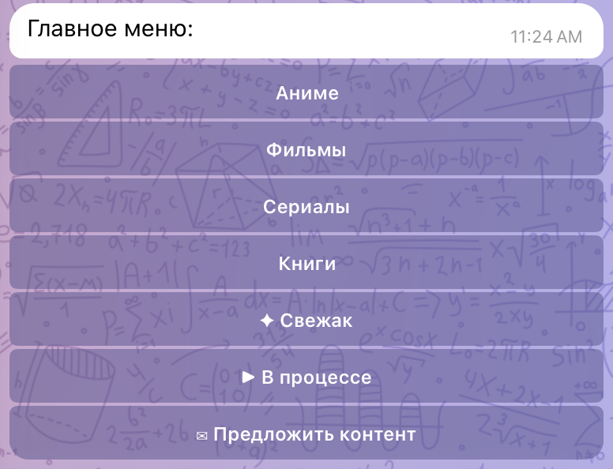
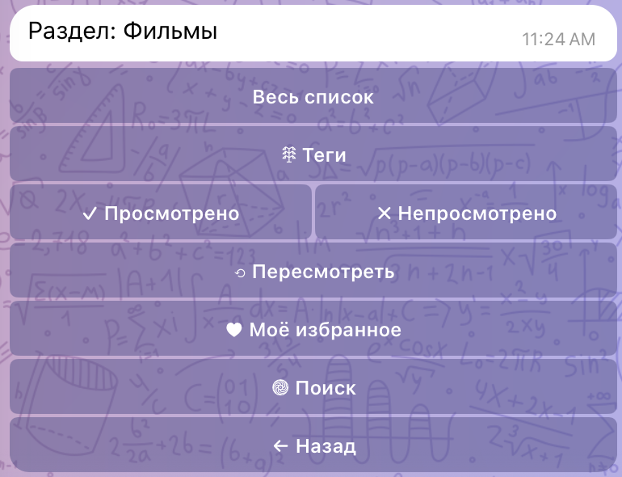
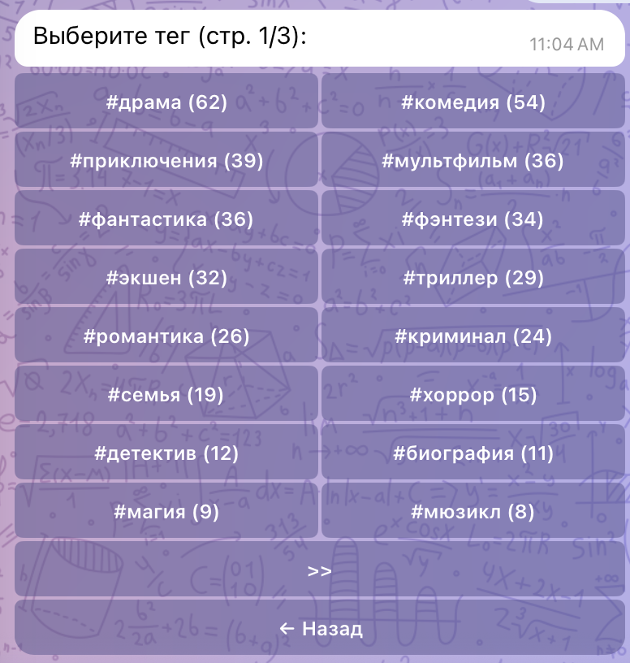
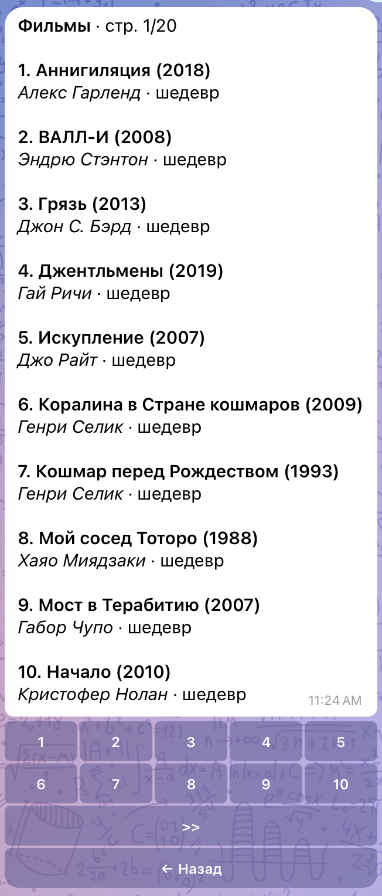
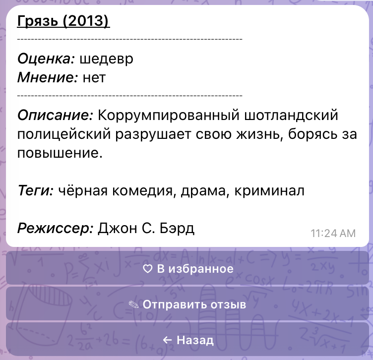
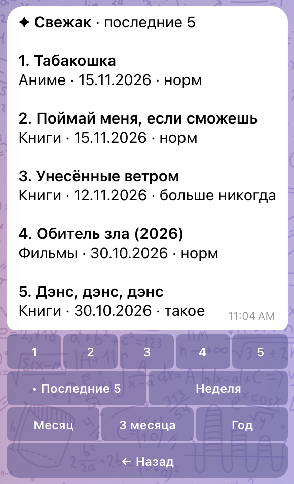
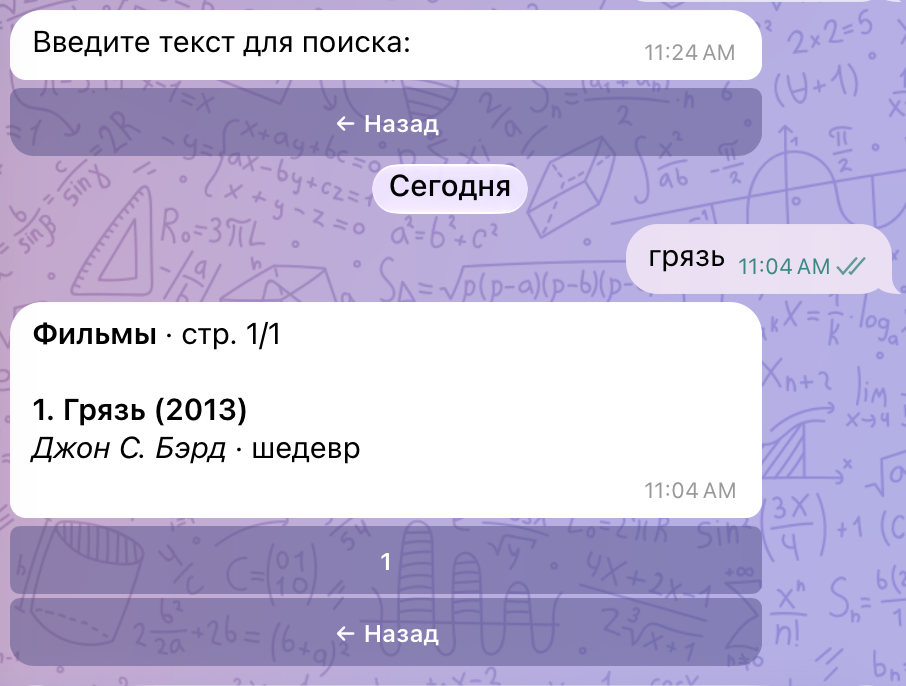
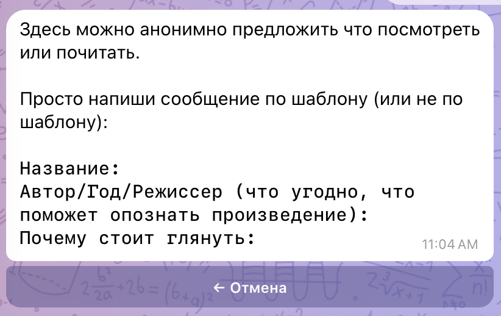
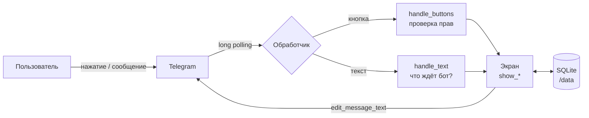

# 📚 murkaS_bot: личный каталог аниме, фильмов, сериалов и книг — Telegram-бот


Бот, в котором хранится всё, что я смотрю и читаю: с оценками, мнениями, тегами и ссылками, где это найти. Я веду каталог, а другие могут его листать, искать себе что-нибудь, отмечать избранное и анонимно писать мне отзывы.

**Попробовать:** [@murkaS_helper_bot](https://t.me/murkaS_helper_bot)

> Это витрина проекта. Исходный код хранится в приватном репозитории.

---

## ✨ Что умеет

- 🗂 **Каталог по разделам**: аниме, фильмы, сериалы, книги. В карточке есть описание, теги, оценка по шкале от «шедевр» до «больше никогда», моё мнение и ссылка, где смотреть или читать.
- 🏷 **Теги**: по популярности, с количеством записей на кнопке, страницами.
- 🔎 **Поиск** по названию. Регистр не важен, в том числе для кириллицы: «НАРУТО», «наруто» и «Наруто» найдут одно и то же.
- ✓ **Фильтры**: просмотрено, непросмотрено, на пересмотр, избранное.
- ✦ **Свежак**: что отметила совсем недавно. Последние 5, неделя, месяц, три месяца, год. «Давно смотрела» в свежак не попадает.
- ▶ **В процессе**: что смотрю или читаю прямо сейчас и где остановилась (сезон и серия, глава и страница). Когда отмечаю запись просмотренной, она уходит из списка сама вместе с прогрессом.
- 👥 **Для гостей**: личное избранное (у каждого своё), анонимные отзывы на записи и анонимные предложения, что посмотреть.

## 🎭 Роли

| | Я (администратор) | Гость |
|---|:---:|:---:|
| Листать каталог, теги, поиск, свежак, «в процессе» | ✅ | ✅ |
| Добавлять, удалять записи | ✅ | — |
| Оценки, мнения, ссылки, отметки «просмотрено», «пересмотр» | ✅ | — |
| Вести «В процессе» и отмечать прогресс | ✅ | — |
| ♥ Избранное | — | ✅ |
| Анонимный отзыв и предложение | — | ✅ |

Админские кнопки проверяются на сервере при каждом нажатии, а не только скрыты в интерфейсе.

## 📸 Как это выглядит

Так бот выглядит для гостя.

<table><tr>
<td align="center" valign="top"><br><sub>Главное меню</sub></td>
<td align="center" valign="top"><br><sub>Раздел: фильтры и поиск</sub></td>
<td align="center" valign="top"><br><sub>Теги по популярности, со счётчиком</sub></td>
</tr></table>

<table><tr>
<td align="center" valign="top"><br><sub>Список с оценками и режиссёрами</sub></td>
<td align="center" valign="top"><br><sub>Карточка записи</sub></td>
<td align="center" valign="top"><br><sub>✦ Свежак: что отмечено недавно</sub></td>
</tr></table>

<table><tr>
<td align="center" valign="top"><br><sub>Поиск без учёта регистра</sub></td>
<td align="center" valign="top"><br><sub>Анонимное предложение контента</sub></td>
</tr></table>

## 🧭 Структура проекта

```
murkaS_bot/
├── main.py            # интерфейс: меню, списки, карточки, обработчики кнопок и текста
├── db_manager.py      # слой данных: схема SQLite, автомиграции, запросы
├── requirements.txt   # зависимости
└── amvera.yml         # конфигурация деплоя на Amvera Cloud
```

**`main.py`** собран из трёх частей:

| Часть | За что отвечает |
|---|---|
| Экраны (`show_*`) | Рисуют текст и клавиатуру: главное меню, раздел, теги, список, карточка, «Свежак», «В процессе» |
| `handle_buttons` | Единая точка входа для всех нажатий. Проверяет права, разбирает `callback_data`, вызывает нужный экран |
| `handle_text` | Принимает обычные сообщения. Что именно ждёт бот (поиск, мнение, прогресс, отзыв), хранится в `user_data` |

**`db_manager.py`** управляет тремя таблицами:

| Таблица | Что хранит |
|---|---|
| `content` | Сами записи: название, описание, теги, сезоны/серии или автор/режиссёр, ссылка |
| `user_actions` | Моя личная оценка записи: просмотрено, пересмотр, оценка, мнение, дата отметки, «в процессе» и прогресс |
| `favorites` | Избранное гостей: пара «пользователь — запись» |

Данные каталога и мои пометки хранятся раздельно, поэтому пометки гостей каталог не засоряют.

## 🔄 Как это работает



## 🛡 Надёжность

Бот сделан так, чтобы им было сложно сломаться.

- **Кнопки ссылаются на запись, а не на её место в списке.** В кнопке лежит `rowid`, который не меняется, пока в каталог добавляют другие записи. Раньше там был порядковый номер: после добавления или удаления он мог открыть чужую карточку.
- **Длинные названия тегов не ломают кнопки.** У Telegram лимит 64 байта на `callback_data`, а кириллица быстро в него упирается. Поэтому в кнопку идёт короткий хеш, а по нему тег находится заново.
- **Устаревшие кнопки** из старых сообщений отвечают «Эта кнопка устарела» и ничего не меняют.
- **Необратимое подтверждается.** Удаление записи спрашивает «точно?». Добавление с уже занятым ID больше не перезаписывает запись молча.
- **Ожидание ввода сбрасывается любым нажатием.** Иначе «Коммент» → «Отмена» → «Ссылка» сохранял бы ссылку как комментарий.
- **Весь пользовательский текст экранируется** (HTML), а длинные поля обрезаются под лимит Telegram в 4096 символов.
- **Глобальный обработчик ошибок:** на неожиданную ошибку бот пишет в лог и отвечает человеку, а не молчит.
- **База обновляется сама.** Новые колонки добавляются при запуске, старая база продолжает работать, данные не теряются.
- **Логи без секретов:** запросы к Telegram, где виден токен, из логов убраны.

### Пример: поиск без учёта регистра

Встроенный `lower()` в SQLite понимает только латиницу, поэтому «Наруто» и «наруто» для него разные слова. Бот подключает к SQLite функцию из Python:

```python
def _execute(self, query, params=(), fetch=False):
    with sqlite3.connect(self.db_path) as conn:
        # SQLite сам не умеет сравнивать русские буквы без учета регистра,
        # поэтому отдаем ему функцию lower() из Python
        conn.create_function("pylower", 1, lambda s: s.lower() if isinstance(s, str) else s)
        ...

# и в запросе поиска:
#   AND (pylower(c.title) LIKE ? OR pylower(c.id) LIKE ?)
```

### Пример: кнопка, которая не вылезает за лимит

```python
def short_key(s):
    """Короткий ключ для тега в кнопке: у Telegram лимит 64 байта на callback_data."""
    return hashlib.md5(s.encode()).hexdigest()[:8]

def find_by_key(values, key):
    for v in values:
        if short_key(v) == key: return v
    raise StaleButton()   # тега с таким ключом больше нет
```

## 🚀 Развёртывание

Бот работает на **Amvera Cloud** (long polling, один контейнер). Токен лежит в переменной окружения, а не в коде. База хранится на постоянном томе `/data`, поэтому переживает перезапуски и пересборки.

## 🧰 Стек

Python 3.11 · python-telegram-bot 20.8+ (long polling) · SQLite · Amvera Cloud

## 🔒 Исходный код

Код закрыт. Если хотите посмотреть его или обсудить проект, напишите мне через профиль на GitHub.
